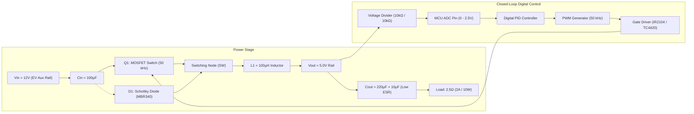

## 1. Design Requirements & Target Specifications

| Parameter | Symbol | Specification / Value | Notes |
| :--- | :---: | :---: | :--- |
| **Input Voltage** | $V_{in}$ | 12.0 V | Nominal DC input rail |
| **Output Voltage** | $V_o$ | 5.0 V | Regulated DC output |
| **Rated Output Current** | $I_o$ | 2.0 A | Continuous load rating |
| **Rated Output Power** | $P_o$ | 10.0 W | $P_o = V_o \times I_o$ |
| **Nominal Load Resistance**| $R_L$ | 2.5 $\Omega$ | $R_L = V_o / I_o$ |
| **Switching Frequency** | $f_s$ | 50 kHz | Period $T_s = 20\ \mu\text{s}$ |
| **Target Efficiency** | $\eta$ | $\ge 85\%$ (92% target) | At full rated load |
| **Output Voltage Ripple** | $\Delta V_o$ | $< 50\text{ mV}_{p-p}$ ($< 1\%$) | Design achieves $\approx 21\text{ mV}_{p-p}$ |
| **Power Stage Topology** | — | Non-synchronous Buck | High-side switch + Freewheeling Schottky |
| **Control Architecture** | — | Digital PID Control | Closed-loop voltage feedback via MCU ADC |

## 2. System Architecture & Block Diagram

